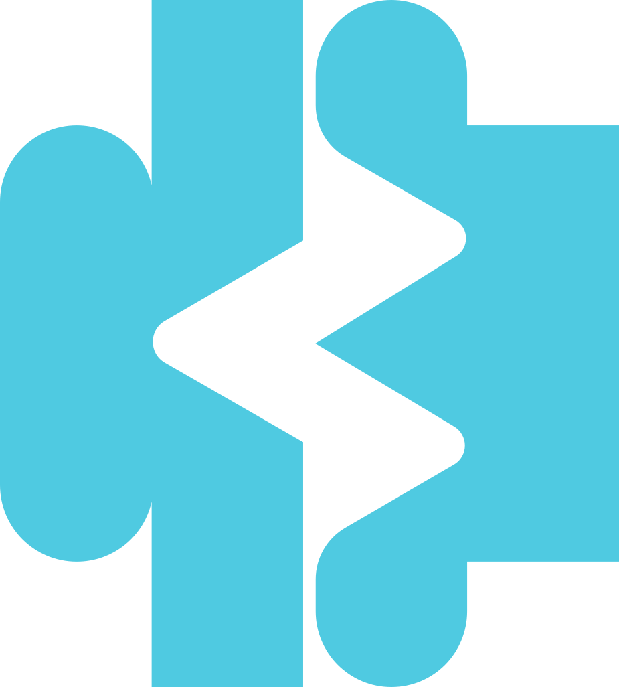

<div align="center">



# Brainova

**Platform teknologi berbasis AI & neurosains kognitif untuk pembelajaran yang lebih baik dan kesehatan mental yang lebih terjaga.**

[](https://laravel.com)
[](https://react.dev)
[](https://inertiajs.com)
[](https://www.typescriptlang.org)
[](https://tailwindcss.com)
[](https://vite.dev)
[](https://www.php.net)

[](https://github.com/Symphoen1x/brainNova/actions/workflows/tests.yml)
[](https://github.com/Symphoen1x/brainNova/actions/workflows/lint.yml)
[](#-lisensi)

[Fitur](#-fitur) · [Tech Stack](#-tech-stack) · [Instalasi](#-instalasi) · [Struktur](#-struktur-proyek) · [Deployment](#-deployment) · [Roadmap](#-roadmap)

</div>

---

## 📖 Tentang

**Brainova** adalah website resmi sekaligus fondasi aplikasi untuk ekosistem produk Brainova, yang menggabungkan kecerdasan buatan dan neurosains kognitif untuk mendukung **SDG PBB** — Pendidikan Berkualitas, Kesehatan & Kesejahteraan, Inovasi, dan Kemitraan.

Antarmukanya futuristik dan *dark-first* (glassmorphism, efek neon glow, mesh gradient), dibangun dengan Laravel 12 + Inertia.js + React 19.

### 🧠 Produk

| Produk | Deskripsi |
|---|---|
| **OLYRA** | Platform pembelajaran adaptif berbasis AI + neurosains yang menganalisis pola kognitif pengguna untuk personalisasi konten secara *real-time*. |
| **Neuro Academy** | Ekosistem pendidikan digital dengan kurikulum berbasis bukti ilmiah dan penilaian neurokognitif untuk institusi pendidikan. |
| **FUMORIVE** | Aplikasi kesehatan mental berbasis *neurofeedback* & pemantauan EEG non-invasif untuk deteksi dini *burnout* dan *anxiety*. |

---

## ✨ Fitur

**Landing page**
- 🏠 **Homepage** dengan 7 section — Hero, About (SDG), Services, Stats (animated counter), Technology, Blog Preview, dan CTA
- 📰 **Blog** — grid artikel dengan filter kategori
- ✉️ **Contact** — form kontak tervalidasi via Inertia `useForm`
- 📬 **Newsletter** — subscribe email yang tersimpan di database (dengan validasi email unik)
- 🌗 **Light / Dark mode** dengan toggle tema

**Aplikasi & autentikasi** (Laravel Fortify)
- 🔐 Login, Register, Reset Password, Verifikasi Email
- 🛡️ Two-Factor Authentication (TOTP) + recovery codes
- ⚙️ Pengaturan akun: profil, password, tampilan (appearance), 2FA
- 📊 Dashboard untuk pengguna terautentikasi

---

## 🛠 Tech Stack

| Layer | Teknologi |
|---|---|
| Backend | [Laravel 12](https://laravel.com) (PHP 8.2+) |
| Frontend | [React 19](https://react.dev) + [TypeScript](https://www.typescriptlang.org) |
| SPA Bridge | [Inertia.js 2](https://inertiajs.com) |
| Styling | [Tailwind CSS v4](https://tailwindcss.com) + [shadcn/ui](https://ui.shadcn.com) (Radix UI) |
| Icons | [Lucide React](https://lucide.dev) |
| Build Tool | [Vite 7](https://vite.dev) |
| Auth | [Laravel Fortify](https://laravel.com/docs/fortify) |
| Routing type-safe | [Laravel Wayfinder](https://github.com/laravel/wayfinder) |
| Database | SQLite (development) / MySQL (production) |
| Testing | [Pest](https://pestphp.com) |
| Code Quality | ESLint, Prettier, Laravel Pint |

---

## 🚀 Instalasi

### Prasyarat

- PHP **8.2+** & Composer **2.x**
- Node.js **20+** & npm **10+**
- Git

### Langkah-langkah

```bash
# 1. Clone repository
git clone https://github.com/Symphoen1x/brainNova.git
cd brainNova

# 2. Install dependency
composer install
npm install

# 3. Siapkan environment
cp .env.example .env
php artisan key:generate

# 4. Siapkan database (SQLite)
touch database/database.sqlite      # Windows PowerShell: New-Item database/database.sqlite -ItemType File
php artisan migrate

# 5. Jalankan development server
composer run dev
```

`composer run dev` menjalankan Laravel server, queue worker, dan Vite (hot reload) secara bersamaan. Buka **http://localhost:8000**.

> 💡 Alternatif cepat: `composer run setup` akan meng-install dependency, membuat `.env`, generate key, migrasi, dan build aset sekaligus.

Panduan lebih lengkap (konfigurasi mail, troubleshooting, dll.) ada di [QUICKSTART.md](QUICKSTART.md).

---

## 📜 Perintah Penting

| Perintah | Fungsi |
|---|---|
| `composer run dev` | Jalankan server, queue, dan Vite sekaligus |
| `composer run dev:ssr` | Mode development dengan SSR |
| `npm run build` | Build aset frontend untuk production |
| `npm run build:ssr` | Build aset + SSR bundle |
| `composer test` | Jalankan Pint (lint check) + test suite |
| `php artisan test` | Jalankan test suite (Pest) |
| `npm run lint` | ESLint dengan auto-fix |
| `npm run format` | Format kode frontend dengan Prettier |
| `npm run types` | Type-check TypeScript |
| `composer run lint` | Format kode PHP dengan Pint |

---

## 🗺 Routes

| Method | URL | Deskripsi |
|---|---|---|
| `GET` | `/` | Homepage |
| `GET` | `/blog` | Daftar artikel blog |
| `GET` | `/contact` | Halaman kontak |
| `POST` | `/contact` | Kirim form kontak |
| `POST` | `/newsletter` | Subscribe newsletter |
| `GET` | `/dashboard` | Dashboard *(auth + verified)* |
| `GET` | `/settings/profile` | Pengaturan profil *(auth)* |
| `GET` | `/settings/password` | Ubah password *(auth + verified)* |
| `GET` | `/settings/appearance` | Pengaturan tampilan *(auth + verified)* |
| `GET` | `/settings/two-factor` | Pengaturan 2FA *(auth + verified)* |

Route autentikasi (`/login`, `/register`, `/forgot-password`, dll.) disediakan oleh Laravel Fortify.

---

## 📁 Struktur Proyek

```
brainNova/
├── app/
│   ├── Actions/Fortify/          # Logika register & reset password
│   ├── Http/
│   │   ├── Controllers/          # Contact, Newsletter, Settings
│   │   ├── Middleware/           # Inertia & appearance
│   │   └── Requests/             # Form request validation
│   └── Models/                   # User, Task
├── database/migrations/          # Users, cache, jobs, 2FA, newsletter, tasks
├── resources/
│   ├── css/app.css               # Tema Brainova (oklch blue/cyan, glass, glow)
│   └── js/
│       ├── components/
│       │   ├── landing/          # Navbar, footer, cards, forms, theme toggle
│       │   └── ui/               # Komponen shadcn/ui
│       ├── hooks/                # Custom React hooks
│       ├── layouts/              # Landing, app, auth, settings layouts
│       └── pages/                # welcome, blog, contact, dashboard, auth, settings
├── routes/
│   ├── web.php                   # Route publik
│   └── settings.php              # Route pengaturan akun
└── tests/                        # Feature & unit test (Pest)
```

---

## 🎨 Design System

Tema menggunakan warna **oklch** dengan aksen biru → cyan neon, ditambah utility class custom:

| Class | Fungsi |
|---|---|
| `.glass` | Kartu glassmorphism (backdrop-blur + opacity) |
| `.glow` | Box shadow neon cyan |
| `.glow-text` | Text shadow neon |
| `.gradient-text` | Teks gradien biru → cyan |
| `.mesh-gradient` | Background radial gradient untuk hero |

---

## 🌐 Deployment

### Shared hosting (Hostinger)

Proyek ini sudah dikonfigurasi untuk shared hosting dengan struktur berikut:

```
home/
├── public_html/      # Isi folder public/ (index.php, build/, aset)
└── brainnova_app/    # Seluruh aplikasi Laravel (app, vendor, storage, dll.)
```

- `public/index.php` memuat aplikasi dari `../brainnova_app`
- `bootstrap/app.php` otomatis memakai `public_html` sebagai public path jika folder tersebut ada

Langkah singkat:

```bash
npm run build
php artisan config:cache
php artisan route:cache
php artisan view:cache
```

Lalu upload isi `public/` ke `public_html/` dan sisa aplikasi ke `brainnova_app/`, kemudian sesuaikan `.env` production (`APP_ENV=production`, `APP_DEBUG=false`, kredensial database MySQL, dan SMTP).

### Firebase Hosting

Konfigurasi Firebase Hosting (`firebase.json`) tersedia untuk menyajikan versi statis dari folder `public/`. Lihat [firebase-deploy.md](firebase-deploy.md) untuk panduan lengkapnya.

```bash
npm install -g firebase-tools
firebase login
firebase deploy
```

---

## 🧪 Testing

```bash
php artisan test
# atau
./vendor/bin/pest
```

CI GitHub Actions menjalankan test (PHP 8.4 & 8.5) dan lint di setiap push / pull request ke `main` dan `develop`.

---

## 🧭 Roadmap

- [ ] Pengiriman email nyata dari form kontak (Mailable + SMTP)
- [ ] Blog CMS berbasis database
- [ ] Halaman produk OLYRA, Neuro Academy, dan FUMORIVE
- [ ] Admin dashboard
- [ ] SEO meta tags (Open Graph, Twitter Card)
- [ ] Integrasi analytics
- [ ] Dukungan multi-bahasa (ID / EN)
- [ ] PWA manifest

---

## 🤝 Kontribusi

1. Fork repository ini
2. Buat branch fitur: `git checkout -b feat/nama-fitur`
3. Commit perubahan: `git commit -m "feat: tambah nama-fitur"`
4. Push ke branch: `git push origin feat/nama-fitur`
5. Buka Pull Request

Pastikan `composer test`, `npm run lint`, dan `npm run types` lulus sebelum membuka PR.

---

## 📄 Lisensi

Proyek ini dirilis di bawah lisensi [MIT](https://opensource.org/licenses/MIT).

<div align="center">

---

Dibuat dengan 💙 oleh tim **Brainova**

</div>
